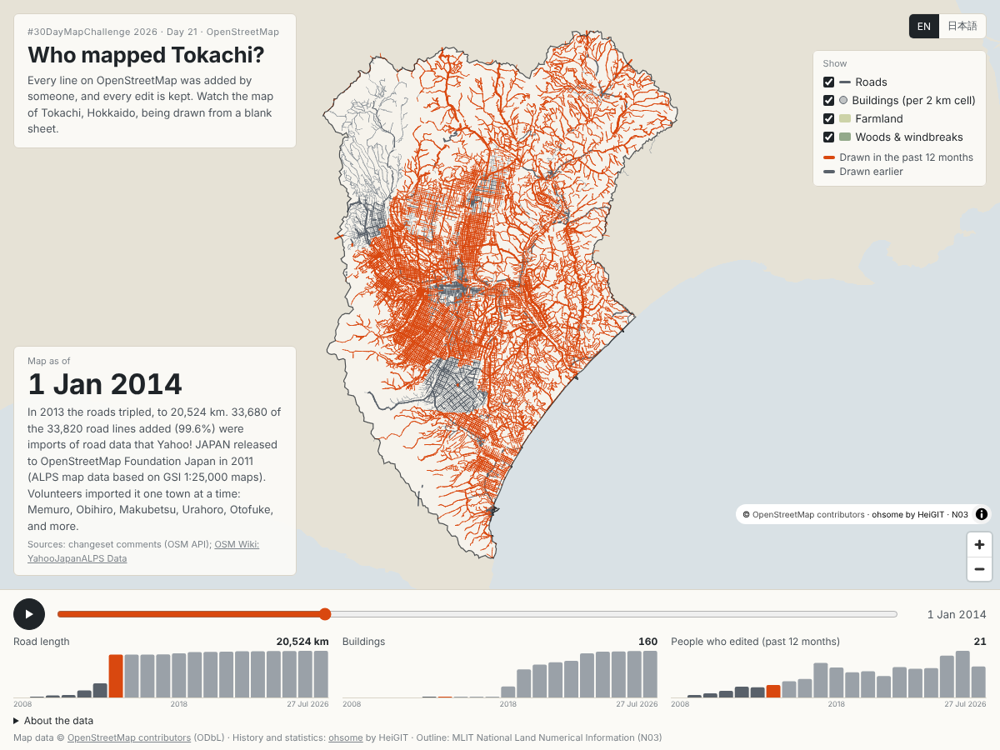

# Who mapped Tokachi?（十勝の地図は、誰が描いた？）

#30DayMapChallenge 2026 · Day 21 · OpenStreetMap

**https://shinyanakashima.github.io/30daymapchallenge-2026day21-who-mapped-tokachi/**



OpenStreetMap (OSM) is drawn by volunteers, and every edit is kept. This web map shows how the OSM map of Tokachi, Hokkaido, filled in year by year from a blank sheet in 2008. Features drawn in the 12 months before each date are shown in orange; older ones in grey. English is the default; switch to Japanese with the button at the top right (or `?lang=ja`).

OpenStreetMap は世界中のボランティアが描く地図で、すべての編集の履歴が残っています。この地図では、北海道・十勝の OSM が 2008 年の白紙から年ごとに描き足されていく様子を見せます。各時点の直前 1 年に描かれたものをオレンジ、それより前のものを灰色で示します。

## Numbers (Tokachi Subprefecture, ohsome API)

| Date | Road length (km) | Buildings | People who edited ways in the previous 12 months |
|---|---:|---:|---:|
| 2008-01-01 | 0 | 0 | 0 |
| 2009-01-01 | 110 | 0 | 4 |
| 2010-01-01 | 1,017 | 0 | 7 |
| 2011-01-01 | 1,190 | 0 | 11 |
| 2012-01-01 | 3,402 | 0 | 18 |
| 2013-01-01 | 6,752 | 140 | 17 |
| 2014-01-01 | 20,524 | 160 | 21 |
| 2015-01-01 | 20,541 | 1,231 | 27 |
| 2016-01-01 | 20,597 | 1,442 | 31 |
| 2017-01-01 | 20,664 | 3,508 | 58 |
| 2018-01-01 | 21,123 | 64,050 | 50 |
| 2019-01-01 | 21,793 | 162,356 | 42 |
| 2020-01-01 | 21,851 | 190,081 | 44 |
| 2021-01-01 | 21,974 | 202,928 | 36 |
| 2022-01-01 | 22,136 | 211,338 | 51 |
| 2023-01-01 | 22,205 | 255,415 | 48 |
| 2024-01-01 | 22,246 | 264,859 | 49 |
| 2025-01-01 | 22,263 | 266,367 | 70 |
| 2026-01-01 | 22,335 | 268,108 | 78 |
| 2026-07-27 | 22,354 | 269,599 | 52 |

The first row counts editors from 8 Oct 2007 (start of the ohsome history) to 1 Jan 2008; the last row covers 1 Jan – 2026-07-27 only (about seven months).

### Why the roads jumped in 2012–2013

| Year | Road ways added | Yahoo! JAPAN / ALPS import | Traced from Bing imagery | Other |
|---|---:|---:|---:|---:|
| 2012 | 10,155 | 3,786 | 6,275 | 94 |
| 2013 | 33,820 | 33,680 | 49 | 91 |

Ways are grouped by the comment of the changeset that first added them (OSM API). Changesets whose comment mentions Yahoo, ALPS or インポート/import are counted as the import; those mentioning Bing as tracing from Bing aerial imagery. In 2013 the import was done municipality by municipality (for example 「Yahoo/ALPSインポート（北海道芽室町）」, 「北海道十勝総合振興局帯広市をYahooデータインポート」). According to the OSM Wiki, Yahoo! JAPAN released this map data (originally held by ALPS, based on GSI 1:25,000 maps) to OpenStreetMap Foundation Japan on 6 March 2011.

2012〜2013年の道路の急増は、主に Yahoo! JAPAN が OSMF Japan に提供した ALPS の道路データの取り込み（市町村ごとのインポート）によるものです。2012年は Bing 航空写真からのトレースも多く含まれます。

## Method / 集計の方法

- **Area**: the Tokachi Subprefecture (十勝総合振興局) outline from MLIT National Land Numerical Information, administrative areas N03 (2024). The mainland polygon was simplified (about 400 m tolerance, holes removed) and sent to the ohsome API as `bpolys`. Small coastal islets are excluded.
- **Dates**: 1 January of each year from 2008 to 2026, plus the latest date in the ohsome database (2026-07-27). Each value is the state of OSM at that moment as stored in the ohsome history database.
- **Statistics** (ohsome API `https://api.ohsome.org/v1/`):
  - road length: `/elements/length`, filter `highway=* and type:way`
  - buildings: `/elements/count`, filter `building=* and geometry:polygon`
  - farmland: `/elements/count`, filter `landuse in (farmland, meadow, orchard) and geometry:polygon`
  - woods and windbreaks: `/elements/count`, filter `natural=tree_row or ((landuse=forest or natural=wood) and geometry:polygon)`
  - people who edited: `/users/count`, filter `type:way`, for the 12 months before each date (the first bar covers 8 Oct 2007 – 1 Jan 2008). Only edits to ways (roads, buildings, land use, rivers, …) are counted; including nodes made the query exceed the API time limit. Only numbers are shown, never user names.
- **Map layers**:
  - roads, farmland, woods: `/contributions/centroid` (with metadata) gives, for every element, when it entered and left the filter. From this the first and last date at which it existed are worked out. Shapes come from `/contributions/latest/geometry` (the latest shape of each element); for elements deleted since, from their last shape before deletion (`/contributions/geometry`). Requests are split into tiles and joined.
  - buildings: `/elements/count/groupBy/boundary` with a grid of about 2 km cells (0.025° × 0.018°), drawn as circles whose area follows the number of buildings.
- **Why the roads jumped in 2012–2013**: for every road way that first appeared in 2012 or 2013, the changeset that added it was taken from `/contributions/centroid` (`@contributionChangesetId`), and the changeset's comment read from the OSM API (`/api/0.6/changeset/{id}`). The results are in `scripts/roads_2012_2013_by_source.json` and `scripts/changesets_roads_2012_2013.json` (the 25 largest changesets; user names are not stored), and were compared with the OSM Wiki.

## Notes / 注記

- All numbers are from the ohsome API, aggregated from the OSM history data available on the date of retrieval. They describe what was in OSM at each date, not what exists on the ground.
- Shapes on the map are each feature's latest (or last) shape, shown from the first date it existed.
- 数値は ohsome API で集計した、取得時点の OSM 履歴データに基づきます。範囲は国土数値情報（行政区域 N03）の十勝総合振興局の管内です。

## Sources / 出典

- Map data © [OpenStreetMap contributors](https://www.openstreetmap.org/copyright), ODbL
- History and statistics: [ohsome API](https://api.ohsome.org/) by [HeiGIT](https://heigit.org/)
- Outline: 国土数値情報（行政区域データ N03, 2024）, MLIT Japan
- Background on the imports: OSM Wiki [YahooJapanALPS Data](https://wiki.openstreetmap.org/wiki/YahooJapanALPS_Data), [YahooJapanALPS Data/Highway](https://wiki.openstreetmap.org/wiki/YahooJapanALPS_Data/Highway)
- Map library: [MapLibre GL JS](https://maplibre.org/)

## Reproduce / 再現手順

```sh
pip install shapely

# 1. Tokachi outline from N03 (download N03-20240101_01_GML.zip from
#    https://nlftp.mlit.go.jp/ksj/ and unzip it)
python scripts/build_boundary.py path/to/N03-20240101_01_subprefecture.geojson

# 2. Statistics and map layers from the ohsome API (takes a while; responses
#    are cached in scripts/.cache)
python scripts/fetch_ohsome.py
python scripts/classify_changesets.py   # 2012–2013 road changesets by comment
python scripts/build_notes.py           # captions and the About text

# 3. Look at it locally
python -m http.server 8080 --directory site

# 4. Check: no console errors or 4xx/5xx, and write docs/screenshot.png
node scripts/check.mjs
```

The site in `site/` is deployed to GitHub Pages by `.github/workflows/pages.yml` on every push to `main`.

## License

Code: MIT (see LICENSE). Data in `site/data/` derived from OpenStreetMap is under the ODbL.
